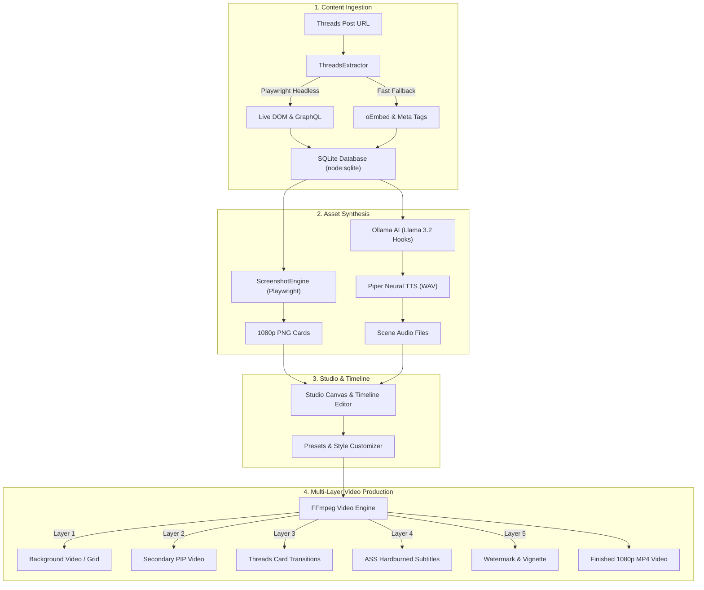

# 🧵 Threads Studio

> **The Autonomous Faceless Video Engine for Threads Creators & MMO Growth Hackers**  
> Turn viral Threads discussions into high-retention TikToks, YouTube Shorts, and Instagram Reels in seconds — **100% Free, Local-First, Zero API Fees**.

[](LICENSE)
[](https://www.microsoft.com/)
[](https://nodejs.org/)
[](https://www.typescriptlang.org/)
[](https://react.dev/)
[](https://ffmpeg.org/)
[](https://playwright.dev/)
[](https://github.com/rhasspy/piper)
[](https://ollama.ai/)

---

## 💡 The MMO (Make Money Online) Playbook

### Why Threads is the #1 Viral Video Arbitrage Opportunity
Short-form platforms (**TikTok Creativity Program Beta, YouTube Shorts Monetization, Facebook Reels Ads**) reward high watch-time and intense comment section debates. Threads is currently the internet's richest source of high-converting drama, confessions, financial hot takes, and relationship debates.

### The Bottleneck for Faceless Channel Operators
| Challenge | Traditional Faceless Workflow | **Threads Studio Engine** |
| :--- | :--- | :--- |
| **TTS Voice Costs** | $50 - $200/mo for ElevenLabs or Azure | **$0 / Unlimited** (Offline Neural Piper TTS) |
| **Card Design & Cropping** | Manual Photoshop / Figma mockups | **Instant Playwright 1080p Headless Render** |
| **Secondary Footage (PIP)** | Tedious CapCut split-screen alignment | **Auto-Looped Secondary Picture-in-Picture** |
| **Subtitle Synchronization** | Manual subtitle timing & text styling | **Auto-Generated ASS Hardburned Subtitles** |
| **Production Speed** | 30 - 45 mins per video | **Under 60 seconds per video (Batch ready)** |

---

## ⚡ Key Features (Phase 1 – Phase 7 Complete)

### 1. Autonomous Batch Automation Engine (Phase 7 - Zero-Touch MMO Workflow)
- **Multi-URL Bulk Intake:** Paste dozens of Threads URLs simultaneously (one per line or comma-separated).
- **Zero-Touch Production Pipeline:** With a single click on `Bắt đầu sản xuất hàng loạt`, the system autonomously:
  1. Deep-scrapes post text, verified author profiles, and top liked comments.
  2. Generates ultra high-definition PNG Threads cards with Playwright.
  3. Synthesizes Vietnamese human-like Neural Voiceovers via Microsoft Edge Neural TTS or Piper.
  4. Composites the MP4 with looped background footage, secondary PIP video, and hardburned ASS animated subtitles.
- **Background Queue & Concurrency Management:** FIFO job scheduler prevents CPU/GPU throttling while running full headless browser and FFmpeg pipelines.
- **Real-Time Progress & Instant Preview:** Watch individual task steps in real-time, view finished MP4s right on the dashboard, and download them with one click.

### 2. Multi-Tier Real Threads Extractor (Phase 1 & 2)
- **Tier 1 (Playwright Deep Scraper):** Automatically opens a headless Chrome/Edge instance, bypasses client-side hydration, intercepts GraphQL payloads, and extracts:
  - Real author handle (`@username`), display name, verified status badge, high-res avatar.
  - Complete post caption text and media attachments.
  - Real reader comments with usernames, avatars, likes count, and timestamps.
- **Tier 2 (Official oEmbed & SSR Parser):** Fast fallback parsing metadata directly from Meta's official oEmbed endpoints and ServerJS JSON state.
- **Manual Quick-Input:** Paste custom stories or scripts using intuitive `Author: Text \n Comment 1 \n Comment 2` notation.

### 3. Neural Voice & AI Script Engine (Zero Cost, Studio Quality) (Phase 4)
- **Microsoft Edge Neural Vietnamese Voices:** Built-in studio-grade neural voiceover for Vietnamese creators (`vi-VN-HoaiMyNeural`, `vi-VN-NamMinhNeural`) with zero API keys or monthly subscriptions required.
- **Full Preset Mapping:** Instant access to 7 distinct voice personalities:
  - *VieNeu - Ngọc Huyền*: Warm, engaging Northern female voice.
  - *VieNeu - Thiện Minh*: Deep, authoritative Northern male news voice.
  - *VieNeu - Hải Đăng*: Energetic Southern male commentary voice.
  - *TikTok Viral 1 & 2*: High-energy social-media robot voices.
  - *Adam bựa*: Witty, humorous commentary voice.
- **Local Piper TTS Option:** Seamless compatibility with local Piper server (`http://localhost:5000`) for fully offline environments.
- **Ollama AI Viral Hook Engine:** Connects to local LLMs (`llama3.2` via `http://localhost:11434`) to analyze threads and generate captivating 3-second scroll-stopping hooks.

### 4. Native Windows Folder Browser & Live Video Canvas Streaming
- **Native Folder Browser Dialog:** Integrates directly with Windows `FolderBrowserDialog` via backend API (`POST /api/media/browse-folder`) — no manual path typing required.
- **Live Local Video Streaming:** Backend HTTP 206 Partial Content server (`/api/media/stream-local`) allows Chrome and Edge to stream and loop local MP4 background and secondary gameplay videos directly inside the live React canvas.

### 5. Multi-Layer FFmpeg Video Compositor (Phase 5 & 6)
- **Dynamic Picture-in-Picture (PIP):** Automatic secondary split-screen overlay for kinetic motion, satisfying clips, or gameplay footage.
- **Hardburned ASS Subtitles:** Word-level highlighted subtitles with customizable font sizes, primary/secondary colors, and positioning (`bottom`, `middle`, `top`).
- **Background Music Mixing:** Automatic audio looping with configurable background music volume (`0% - 100%`).
- **Interactive Timeline Editor (Phase 6):** Drag-and-drop scene ordering, transition selection (Cut, Fade, Slide), and individual scene duration fine-tuning.
- Native Light & Dark theme toggle.
- 9:16 Vertical (Shorts/TikTok/Reels), 16:9 Horizontal (YouTube long-form), and 1:1 Square formats.
- Real-time live card preview in Studio canvas.

### 4. Advanced Multi-Track Timeline Editor
- **Time Ruler & Playhead:** Real-time scrubbing across the video composition.
- **Scene Cards Track:** Drag-and-drop or swap positions with `<` `>` controls, select individual transition effects (*Cut, Fade, Slide Left, Slide Right*).
- **Audio Track:** Per-scene volume sliders (0% - 200%) and duration markers.
- **Subtitle Track:** Synchronized subtitle segments with visual duration blocks.
- **Scene Inspector:** Inspect and fine-tune each comment card's content and voice configuration.

### 5. Multi-Layer FFmpeg Compositor
- **Background Layer:** Dark studio animated checkered grid or your custom video loops.
- **Secondary Video (PIP):** Satisfying secondary background loops (e.g., relaxing motion, kinetic visuals, or gaming footage) with independent scale, position, and border-radius.
- **Card Overlays:** Dynamic animated card positioning and seamless transitions.
- **Subtitle Engine:** Burned-in ASS subtitles with customizable font family, font size, bold weight, primary color, and border outline.
- **Watermark & Effects:** Customizable text branding (channel watermark) and cinematic vignette post-processing.

### 6. One-Click Studio Presets
- 🚀 **TikTok Trending (9:16):** 1080x1920, 30fps, Slide Left transitions, high-contrast subtitles, bottom secondary PIP.
- 📺 **YouTube Shorts Story (9:16):** 1080x1920, 30fps, Fade transitions, warm subtitles, centered card layout.
- ⚡ **Reels Viral Zoom (9:16):** 1080x1920, 60fps, Cut transitions, bold yellow karaoke subtitles.
- 💬 **Square 1:1 Community:** 1080x1080, 30fps, clean community debate format.

---

## 🖥 System Architecture



---

## 🚀 Quick Start Guide (Windows 10 / 11)

### Prerequisites
1. **Node.js** (v20 or v22 recommended): [Download Node.js](https://nodejs.org/)
2. **pnpm** (Recommended):
   ```powershell
   npm install -g pnpm
   ```
3. **FFmpeg**: Ensure `ffmpeg` and `ffprobe` are installed and available in your system `PATH` (or set paths in `server/.env`).

---

### Step-by-Step Installation

#### 1. Clone the Repository
```powershell
git clone https://github.com/Tunaanhgamedev/Threads_Studio.git
cd Threads_Studio
```

#### 2. Install Dependencies
```powershell
.\setup.ps1
```
*This installs root, client, and server dependencies and configures local storage directories.*

#### 3. Launch the Studio (1-Click Run)
Double-click **`CHAY-UNG-DUNG.bat`** (or run `start.bat` in command line).

> 💡 **Desktop App Mode:** The launcher automatically boots up a clean, borderless standalone desktop window titled **Threads Studio** using Google Chrome or Microsoft Edge App Mode!

Alternatively, open your browser manually:
- **Frontend Studio UI:** [http://localhost:5173](http://localhost:5173)
- **Backend API Server:** [http://localhost:3210](http://localhost:3210)

*(Optional: Run `.\Tao-Shortcut-Desktop.ps1` to place a one-click shortcut directly onto your Windows Desktop!)*

---

## 🎙 Setting Up Free Local AI Voice (Piper TTS)

1. **Install Piper and the Vietnamese Neural Model:**
   ```powershell
   .\setup-piper.ps1
   ```
   *Downloads the official Piper binary and the high-clarity `vi_VN-vais1000-medium` voice model directly from HuggingFace.*

2. **Start the TTS Server:**
   Open a separate PowerShell window:
   ```powershell
   .\start-piper.ps1
   ```
   *Runs locally on `http://127.0.0.1:5000` with zero API latency.*

---

## 🤖 Setting Up AI Scriptwriting (Ollama)

1. Install [Ollama](https://ollama.ai/) on your PC.
2. Download the fast, viral-optimized model:
   ```powershell
   ollama pull llama3.2
   ```
3. Threads Studio will automatically detect the local Ollama instance on port `11434` and use it to craft magnetic viral hooks and outro calls-to-action!

---

## 💰 MMO Channel Scaling Blueprint (30 Videos / Day)

### High RPM Niches for Threads Content
1. **Drama & Storytime (AITA / Confessions):** Relatable relationship struggles and office workplace disputes (Highest retention & share rate).
2. **Money, Career & Tech Takes:** Contrarian opinions on salary negotiation, crypto, remote work, and business hustle.
3. **Health, Psychology & Life Lessons:** Deep personal realizations and philosophy that trigger massive save/bookmark metrics.

### Recommended Batch Production Workflow
1. **Batch Sourcing (10 mins):** Paste 10 trending Threads links into the studio dashboard.
2. **Comment Optimization (5 mins):** Use the 1-click filter (*Top 5 Most Liked*) to retain only high-impact comments.
3. **Audio Generation (2 mins):** Click "Generate All Voices" to synthesize neural speech.
4. **Preset Selection (1 min):** Select the *TikTok Trending* or *Reels Viral Zoom* preset.
5. **Batch Render:** Queue videos into the FFmpeg render queue and let your GPU output crisp 1080p MP4 files ready for upload.

---

## 📁 Repository Structure

```
Threads_Studio/
├── client/                     # React 18 + Vite + TailwindCSS Frontend
│   ├── src/
│   │   ├── components/         # TimelineEditor, VideoPreview, UI Controls
│   │   ├── views/              # StudioView, ProjectsView, ScriptView
│   │   ├── services/           # Frontend API client
│   │   └── types.ts            # Studio data models
│   └── vite.config.ts          # Vite configuration with auto-open
├── server/                     # Node.js + Express + SQLite Backend
│   ├── src/
│   │   ├── routes/             # Projects, Voice, Screenshots, Templates
│   │   ├── services/
│   │   │   ├── threadsExtractor.ts   # Multi-tier Playwright & oEmbed scraper
│   │   │   ├── videoService.ts       # FFmpeg compositor & ASS subtitle generator
│   │   │   ├── screenshotEngine.ts   # Playwright card image renderer
│   │   │   ├── voiceEngine.ts        # Piper TTS integration & audio pipeline
│   │   │   └── ollamaService.ts      # LLM hook and script generation
│   │   ├── db.ts               # SQLite initialization & migrations
│   │   └── index.ts            # API server entrypoint (Port 3210)
│   └── .env.example            # Environment variables template
├── storage/                    # Local persistent storage
│   ├── videos/                 # Rendered MP4 video outputs
│   ├── images/                 # Rendered PNG card screenshots
│   └── audio/                  # Synthesized WAV audio segments
├── CHAY-UNG-DUNG.bat           # 1-Click Windows desktop application launcher
├── start.bat                   # CLI Windows batch launcher
├── start.ps1                   # PowerShell launcher
├── setup.ps1                   # Environment and dependency installer
├── setup-piper.ps1             # Local Piper TTS installer
├── start-piper.ps1             # Local Piper TTS server starter
└── Tao-Shortcut-Desktop.ps1    # Windows Desktop shortcut generator
```

---

## 🤝 Contributing

Contributions, feature requests, and bug reports are warmly welcome!  
Feel free to open an issue or submit a Pull Request.

1. Fork the Project
2. Create your Feature Branch (`git checkout -b feature/AmazingFeature`)
3. Commit your Changes (`git commit -m 'feat: add some amazing feature'`)
4. Push to the Branch (`git push origin feature/AmazingFeature`)
5. Open a Pull Request

---

## 📜 License

Distributed under the **MIT License**. See `LICENSE` for more information.

---

<p align="center">
  <b>Built with ❤️ for Content Creators, Video Automators & Growth Hackers worldwide.</b>
</p>
